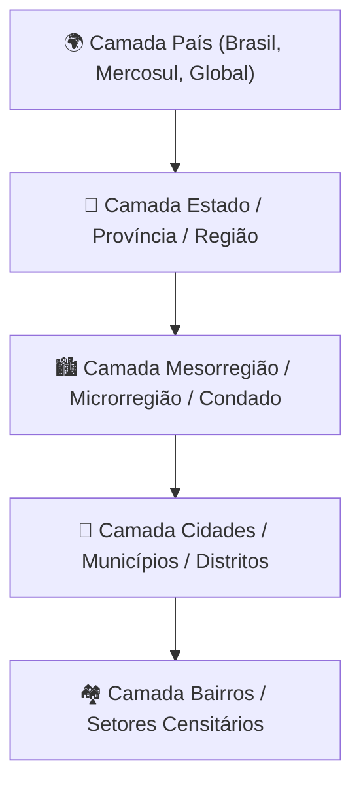

# 🗺️ Gestor de Representantes por Município no Brasil

> **Aplicação Web Interativa para Gestão, Distribuição Comercial e Mapeamento Territorial Multimarca**

Uma solução corporativa e intuitiva para visualização, divisão de áreas de atuação e gestão de representantes comerciais em todos os municípios dos 27 estados do Brasil, utilizando dados geográficos oficiais do **IBGE**, renderização cartográfica via **Leaflet** e exportação de pacotes comerciais completos (.zip com Imagem, Planilha Excel formatada e Relatório Executivo em PDF).

---

## 🚀 Funcionalidades Principais

### 1. 📍 Cartografia Interativa e Dados Oficiais do IBGE
* **Integração Dinâmica com a API do IBGE**: Carregamento instantâneo da malha geográfica precisa de qualquer um dos 27 Estados brasileiros e de seus respectivos municípios em formato GeoJSON.
* **4 Camadas de Visualização**:
  * **Satélite (Esri World Imagery)**: Fotografias aéreas de alta definição ideais para relatórios executivos.
  * **OpenStreetMap**: Mapeamento urbano e rodoviário detalhado.
  * **Google Maps**: Visualização clássica da malha viária e localidades.
  * **CartoDB Light**: Fundo minimalista de alto contraste com destaque absoluto para as divisões territoriais.
* **Contorno e Divisões Inteligentes**: Adaptação dinâmica da cor e espessura das fronteiras municipais de acordo com a camada selecionada, garantindo visibilidade ideal.

### 2. 🏷️ Suporte Multimarca (Até 6 Marcas por Município)
* **Até 6 Marcas Simultâneas**: Um mesmo município pode ter representantes de marcas diferentes ou parceiras (ex: Marca 1 a Marca 6).
* **Renderização Dinâmica**:
  * **1 Marca**: Preenchimento sólido com a cor atribuída ao representante.
  * **2 a 6 Marcas**: Preenchimento especial por listras geométricas multicoloridas em SVG (listras diagonais com as cores de cada marca/representante atuante na localidade).
* **Modal de Renomeação de Marcas**: Possibilidade de atribuir nomes corporativos reais às marcas diretamente pela interface.

### 3. 🎯 Rótulos Verticais Compactos e Despoluição Visual
* **Rótulos Estreitos (Sem Sobreposição)**: Otimizados com quebra de linha vertical para caber perfeitamente no interior dos polígonos municipais, evitando o amontoamento de texto em cidades adjacentes.
* **Inspeção em Duplo Nível**:
  * **Visualização Base**: Exibe o Município e o(s) Representante(s) de forma limpa.
  * **Hover e Clique**: Exibe um card flutuante translúcido detalhado com todas as marcas, números sequenciais e identificação cromática.
* **Controle de Rótulos e Divisões**: Botões de alternância (`[✓] Divisões Municipais` e `[✓] Rótulos`) para deixar o mapa 100% limpo quando desejado.

### 4. 🖥️ Modo Tela Cheia com Painel Flutuante Duplo
* **Imersão Total**: Expansão instantânea para tela cheia com reenquadramento automático.
* **Controles Verticais no Canto Superior Direito**:
  * **Painel de Camadas**: Alternância rápida entre Satélite, OSM, Google e CartoDB.
  * **Painel de Ajustes**: Alternância de Divisões, Rótulos, Botão de Reenquadramento do Estado e Botão de Saída rápida da tela cheia.

### 5. ✍️ Cadastro Manual e Importação em Massa via Planilha
* **Cadastro Manual Ágil**: Seleção por seletor ou por **clique direto no mapa**, memorização automática da cor atribuída ao representante e gerador de cores aleatórias.
* **Importação via Excel (.xlsx)**:
  * Download de planilha modelo pré-formatada para o estado ativo.
  * Upload com leitura de colunas (`ID IBGE`, `Município`, `Marca`, `Representante`, `Cor Hex`).
  * Processamento assíncrono em lotes com barra de progresso em tempo real e proteção contra limite de marcas.

### 6. 🔒 Privacidade e Segurança: 100% em Memória Volátil (RAM)
* **Zero Persistência em Disco / Sem LocalStorage**: Por diretriz de confidencialidade e segurança, todas as informações cadastradas residem exclusivamente na memória RAM da sessão do navegador.
* **Proteção contra Perda Acidental**: Alerta do navegador (`beforeunload`) para prevenir fechamento ou recarregamento involuntário da página.

### 7. 📦 Exportação Completa de Pacote (.zip)
Ao clicar em **Baixar Pacote (.zip)**, o sistema compila instantaneamente:
1. **Foto PNG do Mapa**: Imagem em alta resolução (scale: 2x) que reenquadra automaticamente o estado selecionado, eliminando riscos de cortes por movimentação prévia do mapa.
2. **Planilha Excel Estilizada (.xlsx)**: Gerada via **ExcelJS**, com cabeçalho corporativo roxo, linhas zebradas e células de cores preenchidas visualmente em ARGB idênticas às cores do mapa.
3. **Relatório Executivo em PDF (2 Folhas)**:
   * **Folha 1 (Visual)**: Cabeçalho com dados da emissão e mapa colorido do Estado em alta definição ocupando a página.
   * **Folha 2 (Tabela & Legenda)**: Resumo executivo com contadores de cobertura, e tabela centralizada completa com Número, Município, Marca, Representante e Amostra Gráfica da Cor.

---

## 🔮 Projeção Futura & Roadmap Arquitetural

Visando a evolução da plataforma para atender grandes redes de distribuição globais e multinacionais:



### Principais metas do Roadmap:
1. **Navegação Hierárquica Multi-Nível (País ➔ Estado/Província ➔ Município ➔ Bairro)**:
   * Permitir seleção de país de atuação (Brasil, Argentina, Chile, Estados Unidos, etc.).
   * Drill-down territorial: zoom out para ver a distribuição nacional e zoom in gradual revelando subdivisões de estados/províncias até níveis intra-urbanos.
2. **Sugestão Inteligente de Divisões**:
   * Algoritmo de roteirização e clusterização territorial baseado em distância geográfica, população estimada e capacidade de atendimento por representante.
3. **KPIs Comerciais Integrados**:
   * Cruzamento com dados de faturamento, metas comerciais por território e identificação visual de cidades sem cobertura (zonas de oportunidade).

---

## 🛠️ Tecnologias e Bibliotecas Utilizadas

* **Linguagens e Core**: HTML5 Semântico, CSS3 Moderno, JavaScript Vanilla (ES6+ modular).
* **Design e UI**: [Tailwind CSS](https://tailwindcss.com/) (CDN), ícones SVG vetorizados, tipografia corporativa de alto contraste.
* **Cartografia**: [Leaflet.js](https://leafletjs.com/) + Tiles Esri World Imagery, OpenStreetMap, Google Maps e CartoDB.
* **Serviços de Dados**: [API de Malhas Geográficas e Localidades do IBGE](https://servicodados.ibge.gov.br/api/docs).
* **Exportação e Arquivos**:
  * [dom-to-image](https://github.com/tsayen/dom-to-image) — Captura de screenshots em escala de alta densidade.
  * [ExcelJS](https://github.com/exceljs/exceljs) — Geração de planilhas Excel avançadas com estilo ARGB nas células.
  * [SheetJS (xlsx)](https://sheetjs.com/) — Leitura e importação rápida de arquivos de planilha.
  * [jsPDF](https://github.com/parallax/jsPDF) & [jspdf-autotable](https://github.com/simonbengtsson/jsPDF-AutoTable) — Construção do relatório executivo em PDF de 2 folhas.
  * [JSZip](https://stuk.github.io/jszip/) & [FileSaver.js](https://github.com/eligrey/FileSaver.js/) — Empacotamento e download do arquivo `.zip`.

---

## 💻 Como Executar

A aplicação é 100% estática e não necessita de servidores de aplicação complexos ou banco de dados:

1. Clone o repositório:
   ```bash
   git clone https://github.com/LucasLeite19/mapa_representantes.git
   ```
2. Abra a pasta do projeto:
   ```bash
   cd mapa_representantes
   ```
3. Abra o arquivo `index.html` em qualquer navegador web moderno (Google Chrome, Microsoft Edge, Mozilla Firefox, Safari) ou utilize uma extensão local como o *Live Server* do VS Code.

---

## 📄 Licença

Desenvolvido para fins de gestão territorial comercial e visualização estratégica de representantes.
